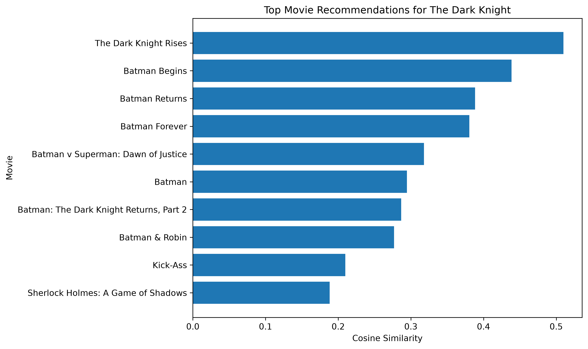

# Movie Recommendation System

A content-based movie recommendation system built with Python and scikit-learn using the TMDB 5000 Movie Dataset.

The system analyzes movie information such as genres, keywords, overview, cast, and director to recommend movies with similar content.

## Project Overview

Recommendation systems are widely used by platforms such as movie and streaming services to help users discover relevant content.

In this project, a **content-based filtering** approach is used. Instead of relying on user ratings or historical user behavior, the system recommends movies based on similarities between their available metadata.

## Objectives

* Explore and preprocess movie datasets
* Combine movie and credits information
* Extract useful movie metadata
* Create a combined text representation of each movie
* Convert movie information into numerical features using TF-IDF
* Calculate movie similarity using cosine similarity
* Build a movie recommendation function
* Visualize recommendation similarity scores

## Dataset

The project uses the **TMDB 5000 Movie Dataset**, consisting of two files:

* `tmdb_5000_movies.csv`
* `tmdb_5000_credits.csv`

The datasets contain information such as:

* Movie titles
* Movie overviews
* Genres
* Keywords
* Cast
* Crew
* Popularity
* Ratings and vote counts
* Movie metadata

The datasets are stored locally in the `data/` directory.

## Machine Learning Approach

This project uses **content-based filtering**.

The main workflow is:

```text
Movie Dataset
      ↓
Data Exploration
      ↓
Merge Movie + Credits Data
      ↓
Feature Selection
      ↓
Metadata Processing
      ↓
Create Movie Tags
      ↓
TF-IDF Vectorization
      ↓
Cosine Similarity
      ↓
Recommendation Function
```

## Feature Engineering

The following movie information is combined into a single `tags` column:

* Overview
* Genres
* Keywords
* Top three cast members
* Director

This combined text representation allows the recommendation system to compare movies based on their content.

## TF-IDF

**TF-IDF (Term Frequency-Inverse Document Frequency)** is used to convert the movie tags into numerical vectors.

A maximum of 5,000 features is used, with common English stop words removed.

```python
tfidf = TfidfVectorizer(
    stop_words="english",
    max_features=5000
)

tfidf_matrix = tfidf.fit_transform(df["tags"])
```

## Cosine Similarity

Cosine similarity is used to measure the similarity between movie vectors.

Movies with more similar metadata receive higher similarity scores.

```python
similarity = cosine_similarity(tfidf_matrix)
```

The resulting similarity matrix contains similarity scores between the movies in the dataset.

## Example Recommendation

The recommendation function accepts a movie title and returns the most similar movies.

Example:

```python
recommend("The Dark Knight", n=10)
```

The system then displays the recommended movies together with their cosine similarity scores.

## Visualization

The project includes a visualization of the top recommendations for **The Dark Knight**.



## Project Structure

```text
movie-recommendation-system/
│
├── data/
│   ├── tmdb_5000_movies.csv
│   └── tmdb_5000_credits.csv
│
├── images/
│   └── recommendation_similarity.png
│
├── movie_recommendation.ipynb
├── README.md
├── requirements.txt
└── .gitignore
```

## Technologies Used

* Python
* Pandas
* NumPy
* Matplotlib
* Scikit-learn
* Jupyter Notebook

## How to Run

### 1. Clone the repository

```bash
git clone https://github.com/Rajesh-code11/movie-recommendation-system.git
```

### 2. Navigate to the project

```bash
cd movie-recommendation-system
```

### 3. Install the dependencies

```bash
pip install -r requirements.txt
```

### 4. Open the notebook

```bash
jupyter notebook movie_recommendation.ipynb
```

Alternatively, the notebook can be opened directly in VS Code with the Jupyter extension.

## Key Concepts Demonstrated

This project demonstrates practical understanding of:

* Data cleaning
* Feature engineering
* Text preprocessing
* TF-IDF vectorization
* Cosine similarity
* Content-based recommendation systems
* Pandas data manipulation
* Data visualization
* Building a practical machine learning application

## Limitations

This recommendation system is content-based, so recommendations depend on the available movie metadata.

It does not use:

* User ratings
* User history
* Collaborative filtering
* Personalized user preferences

Therefore, two users entering the same movie will receive the same recommendations.

## Conclusion

This project demonstrates how text-based machine learning techniques can be used to build a practical movie recommendation system.

By combining movie metadata, TF-IDF vectorization, and cosine similarity, the system can identify movies with similar content and generate recommendations for a selected movie.
